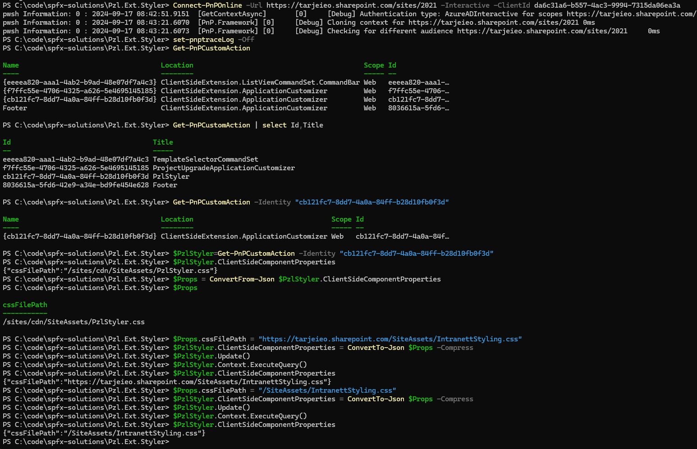

# pol-styler

## Summary

This Application customizer lets you override any and all CSS on SharePoint pages across the site collection. Create a Document library named 'Styling' under /sites/cdn/ and place your CSS file named `PolStyler.css` there. The path can also be configured, see further down on this page for examples.

Add the Pol.Styler app to your SharePoint sites to enjoy the style of the day for the sites you choose to add it to.

## Used SharePoint Framework Version


SPFx 1.24.1 is Microsoft's November 2026 maintenance release. Use Node.js 26
(`nvm use`); Node 22.14+ and Node 24 are also supported by this toolchain.
See [Microsoft's compatibility reference](https://learn.microsoft.com/en-us/sharepoint/dev/spfx/compatibility).

## Applies to

- [SharePoint Framework](https://aka.ms/spfx)
- [Microsoft 365 tenant](https://docs.microsoft.com/en-us/sharepoint/dev/spfx/set-up-your-developer-tenant)

## Prerequisites

SharePoint Administrator for app catalog deployment.
We recommend that site owners add the extention manually per site.

## Solution

| Solution       | Author(s)                                               |
| -------------- | ------------------------------------------------------- |
| Pol.Styler | Pål Olav Loftesnes (www.paalolav.no)                    |

## Version history

| Version | Date             | Comments        |
| ------- | ---------------- | --------------- |
| 1.2     | April 10, 2025 | Rebrand, update to SPFX 1.20 |
| 1.1     | September 17, 2024 | Flexible CSS path |
| 1.0     | August 24, 2023 | Initial release |

## Disclaimer

**THIS CODE IS PROVIDED _AS IS_ WITHOUT WARRANTY OF ANY KIND, EITHER EXPRESS OR IMPLIED, INCLUDING ANY IMPLIED WARRANTIES OF FITNESS FOR A PARTICULAR PURPOSE, MERCHANTABILITY, OR NON-INFRINGEMENT.**

---

## Minimal Path to Awesome

- Clone this repository
- Ensure that you are at the solution folder
- in the command-line run:

```bash
npm ci
```

```bash
npm test
npm run build
```

# Watching the code 
```bash
npm start
```

## Features

Extension that enables you to add CSS styling to any SharePoint site.
Using the sample file, we remove the site header for all news stories in the OOTB News web part.

Before Pol.Ext.Styler is installed:

[](images/Styler%20off.png)

After Pol.Ext.Styler is installed:

[](images/Styler%20on.png)

Here we've added border radius to the weather web part and changed colours and border radius on the Quick Links web part:

[](images/Weather%20and%20quicklinks.png)

## Configuration

The path to the CSS file can be configured per site, making it possible to load different CSS files for different sites. The file is loaded as a ClientSideComponentProperty of the PolStyler Custom Action.

Use `/sites/cdn/Styling/PolStyler.css`, a tenant-root-relative path without the
leading slash, or an absolute HTTPS URL on the current SharePoint origin.
External hosts, alternate ports, HTTP, embedded credentials, protocol-relative
URLs, backslashes, control characters, and non-string values are rejected.
Rejected configuration loads no stylesheet and logs a generic warning without
including the configured URL. Existing external-CDN configurations must move
their stylesheets to the tenant before adopting this version.

Only trusted administrators should edit the custom action or stylesheet library.
This validates the initial URL, not CSS contents, redirects, nested `@import`
rules, or image/font requests. A trusted stylesheet can still alter the entire
page and request external resources. Avoid redirects and review stylesheet
changes and library permissions before deployment.

Security checks and remaining validation are tracked in [tasklist.md](tasklist.md).

See example configuration:

[](images/PowerShell_Example_Usage.png)
